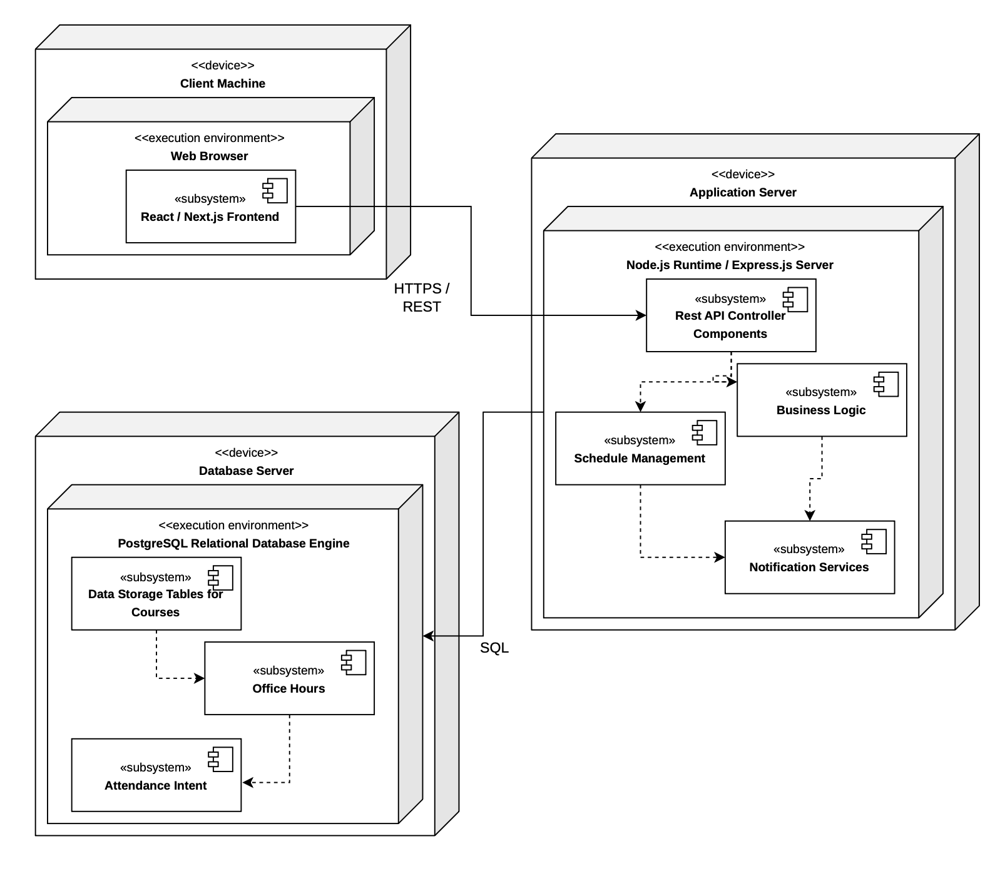

# AcademicWeaponsTAFinder

## Members:
- Chris Trostel
- Eldar Cakolli
- Kurt Grenzberg
- Jacob Taylor

## Project Purpose:
We are creating a TA Finder system to help students and find locations and times easier and help TAs manage their office hours if needed to make asking and getting help easier. One major thing our team is currently unsure about is how smoothly we will be able to integrate and synchronize real-time notification alerts for schedule changes without running into performance or configuration hurdles during university authentication.

## UML Deployment Diagram:

## Tech Stack
| Layer | Technology | Justification |
| :--- | :--- | :--- |
| **Language** | JavaScript/TypeScript (Node.js) | Supports rapid full-stack development and shared typing. |
| **Frontend** | React / Next.js | Fulfills student/TA UI components and dynamic schedule views. |
| **Backend** | Node.js with Express | Provides a lightweight REST API for authentication and routing. |
| **Database** | PostgreSQL | Relational integrity for Courses, Enrollments, Office Hours, and Attendance. |

## Subsystem Decomposition & Repository Structure
Our codebase is structured into a monorepo mirroring our Sprint 3 architecture:
* `/client` — Frontend user interface components (Student dashboard, TA views, attendance toggles).
* `/server` — Backend REST API controllers, business logic, and database management.
* `/docs` — Architecture diagrams and sprint documentation.

## How to Run the Skeleton
### Prerequisites
* Node.js (v18+)
* PostgreSQL installed locally or via cloud instance.